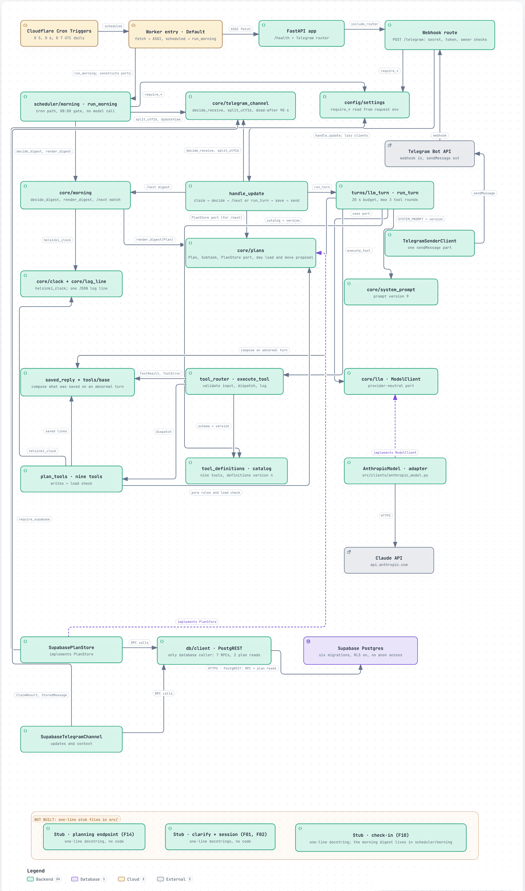

# jarvis-compass

A personal planning assistant that lives in Telegram. You write what you want to get done, in Vietnamese. It turns the goal into dated tasks, stores them, warns you when a day holds more than 8 hours of work, and sends a short plain-text digest of what is due at 08:00 Helsinki time.

It is the planning backend for a larger personal-assistant idea (JARVIS), built by one person for personal use. It runs as a Cloudflare Python Worker with Supabase Postgres and Claude Haiku 5.5. Version 1 is finished and frozen (see [Status](#status)).



*Architecture at commit `8da974e`. The interactive version is `docs/architecture/architecture.html`; open it in a browser after cloning.*

## What it does

- **Plans from chat.** A message with a goal becomes a plan with dated tasks. Every task has an end point that can be checked and a size: S, M or L (1, 3 or 6 hours). The bot asks back when the request is ambiguous.
- **Edits by talking.** Mark a task done or skipped, add a task, add a note, set a plan's priority (low, medium, high) or a task's size, move dates.
- **Load check.** A day has a budget of 8 hours. When a new task or a date change would push a day over, the bot writes nothing. It names the day, the total and the tasks it would move, and where. It writes only after you confirm in the next message. A task with no size counts as 3 hours, and the warning says that is a guess. Every moved task leaves a row in an append-only history table.
- **Morning digest.** At 08:00 Helsinki time a scheduled script sends what is due, without calling the model. `/next` shows the digest on demand.
- **One user, text only.** The bot accepts messages only from its owner's Telegram id. Voice, photos and files get a fixed reply.

## How it is built

- A Cloudflare Worker (Python, FastAPI through ASGI) receives the Telegram webhook and the cron triggers. Supabase Postgres holds plans, tasks, move history and the Telegram channel state. The Worker reaches it through PostgREST over HTTPS, because TCP database drivers do not work on the Pyodide-based Python Workers runtime (D-010).
- A message passes the webhook checks, then the update is claimed so it is processed once, then a model turn runs (20 second budget, at most three tool rounds), the tools read and write the store, and the reply is split to Telegram's size limit and sent.
- There are nine tools. The model chooses tools and words the reply. Code does everything that has to be exact: dates, day load, which tasks to move, version checks.
- Layers are enforced. `src/core` is plain Python with the standard library only. `turns`, `tools`, `db` and `clients` sit around it, and `scripts/check.ps1` checks the import rules, a per-change file allow list and that no test is skipped before every merge.

## Decisions worth reading

The full records are in `docs/DECISIONS.md` (Vietnamese). Five that shaped the code:

- **Code computes, the model reports (D-024, D-029).** Models make arithmetic mistakes, so the day load and the list of moves are computed in code. The tool builds the warning and the model relays it. The evals check that it relays it faithfully.
- **A soft warning, then an explicit yes (D-029).** The first call never writes. The write happens on a later turn with a confirm flag and the exact move list. A failure halfway is not rolled back, because the history table is append-only and a rollback would add reverse rows.
- **Writes survive bad turns (D-021).** Plans carry a version and every write is an update that checks it, so two overlapping turns cannot overwrite each other. Each store call has a timeout taken from what is left of the turn's budget. If a turn ends abnormally after something was saved, the reply is composed from what was saved.
- **Each Telegram update is handled once (D-022, D-023).** The update id is claimed in the database before any work, and the reply is stored before it is sent. One bug found on the real Worker: its HTTP client crashes on the empty body that PostgREST returns for functions that return void, after the write has already finished. Every RPC now returns a value.
- **The digest does not trust the cron clock (D-025).** Cloudflare crons run in UTC and ignore daylight saving. Three crons fire at 05:00, 06:00 and 07:00 UTC, and code decides whether it is 08:00 in Helsinki yet. That covers summer and winter time and allows a retry on the same day. One database row per Helsinki day, with a negative update id, keeps it to one digest.

## Results

The evals use the real model. Each case runs three times against Claude Haiku 5.5 with a fixed clock. Scoring is deterministic checks on tool calls, replies and the final store, with no model as judge. Final runs:

| Suite | Cases | Focus | Tool choice (runs) | Final store (runs) |
| --- | --- | --- | --- | --- |
| v1 | 50 | general tool use | 150/150 | 45/45 |
| v2 | 17 | dates, priority, effort, deadline clashes | 44/45 | 44/45 |
| v3 | 8 | day load check | 22/24 | 23/24 |

These numbers come from [`docs/EVAL_REPORT.md`](docs/EVAL_REPORT.md), which `evals/report.py` generates from the result files. The report also lists every round, every failed run and the exact scoring rules.

The largest finding was in the scorer, not the model. One rule scored a group at 0 to 13 percent for ten days. Reading 15 replies by hand showed the model was right, and 13 of the 15 failures in one v1 run came from that rule. With the rule fixed, the same prompt scored 150/150.

Other checks:

- 811 tests pass with none skipped, against a local Supabase.
- A simulation runs the real tools against an in-memory store with a fake clock and no model. It plays a scripted fourteen-day scenario, kept as a golden transcript in [`docs/simulation/fortnight.md`](docs/simulation/fortnight.md), and six randomized runs. Invariants are checked after every action.

## Cost

One chat turn averages about 13,500 input tokens and 350 output tokens, measured over the 150 turns of the v1 suite. About 6,200 of the input tokens are the fixed instructions and tool catalog, sent with every model call. At the prices recorded in `docs/PRODUCT.md` (0.10 USD per million input tokens, 0.50 USD per million output tokens) that is about 0.0015 USD per turn. At 15 turns a day that is about 0.7 USD a month, plus 5 USD a month for Cloudflare Workers Paid. These are estimates from token counts, not invoices.

## Known limitations

- **Not used for weeks.** The system was exercised by the evals and the simulation, not by long daily use.
- **Several moves in one write are not atomic.** Each moved task is its own write. If one fails, the earlier ones stay saved and the reply says what moved. Code review found two gaps, from reading the code, not reproduced in tests (`docs/reviews/2026-11-11-repo-review.md`, Q4-01 and Q4-02). A step that timed out is reported as not moved although it may have been saved. If the turn then ends abnormally, the reply can leave out changes that were saved. The stored data stays consistent; the message can be wrong or incomplete.
- **The confirm flag is not proof of consent.** The model sets it. In 2 of 6 runs of one eval case (V3-07) it reached the right final state through a path that skips the deadline-clash check. This is accepted in D-029.
- **Plan-wide deadline cases vary.** P04 (v1) and V2-06 (v2) have moved between 0.67 and 1.0 from run to run since prompt version 6.
- **Overdue tasks are never moved automatically.** They count as zero load and stay at the top of the digest until marked done.
- **Plan reads are unbounded.** The load check reads the whole store. This has not been measured at scale.
- **One interface.** Telegram is the only way in. `src/api/routes_planning.py` is a stub, so there is no tool interface for other programs.
- **Vietnamese only.** The assistant's prompts and replies are Vietnamese. The internal docs are Vietnamese too; this README and the eval report are English.

## Run it

Needs Python 3.13 or newer, [uv](https://docs.astral.sh/uv/), Node (for the Supabase CLI through `npx`), Docker, and PowerShell on Windows. The exact commands, including local Supabase setup, are in `AGENTS.md` (Vietnamese). In short:

```powershell
uv sync

# Local database for the tests, with the CLI version pinned
npx --yes supabase@2.122.0 start
npx --yes supabase@2.122.0 db reset
$s = npx --yes supabase@2.122.0 status -o json | ConvertFrom-Json
$env:JARVIS_TEST_SUPABASE_URL = $s.API_URL
$env:JARVIS_TEST_SUPABASE_KEY = $s.SERVICE_ROLE_KEY
uv run pytest
```

The eval runner calls the Anthropic API. A pass over all three suites costs about 0.4 USD and takes about 10 minutes:

```powershell
$env:PYTHONPATH = "src"
$env:JARVIS_EVAL_ANTHROPIC_KEY = "<your key>"
uv run python -m evals.runner
```

`uv run pywrangler dev` and `uv run pywrangler deploy` run the Worker locally and deploy it, from WSL Ubuntu with a separate virtualenv (see `AGENTS.md`). Secrets are never in the repo; `.env.example` lists the variable names.

## Repository map

- `src/` Worker code: `api`, `core`, `turns`, `tools`, `db`, `clients`, `scheduler`, `config`, and `entry.py`.
- `tests/` unit and integration tests, and the simulation. `evals/` is the eval runner, scorer and report generator, outside the Worker bundle.
- `supabase/migrations/` the schema, as six migrations.
- `specs/` one folder per feature (spec, plan, tasks), made with Spec Kit.
- `docs/` `PRODUCT.md`, `ARCHITECTURE.md` and `DECISIONS.md` (Vietnamese), `EVAL_REPORT.md` (English), `simulation/`, `architecture/`, and `reviews/` with the four repo reviews (Vietnamese).

## Status

Version 1 is complete and frozen (D-028): the Telegram bot, the morning digest, the load check, the evals and the simulation. New features are added only when daily use shows a real gap. Next is a one-week trial of an open-source personal assistant with compass plugged in as a tool, to decide how much of the surrounding assistant is worth building.
